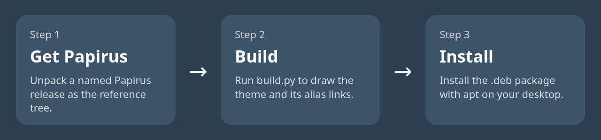
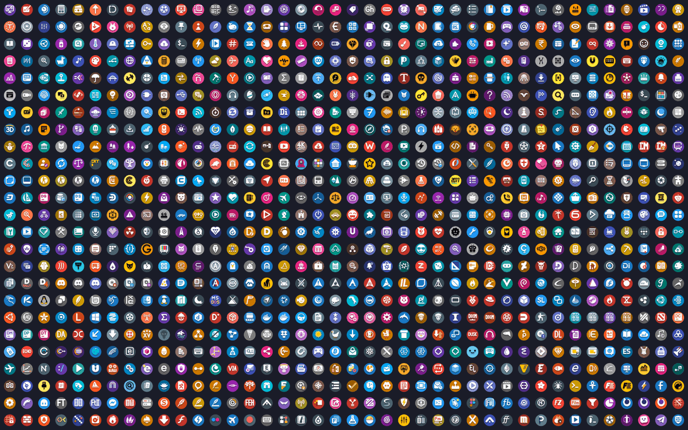

<p align="center">
  
</p>

<p align="center">
  <a href="CHANGELOG.md"></a>
  <a href="LICENSE"></a>
  <a href="https://github.com/trindle-os/trindle-icons/releases"></a>
  
</p>

Trindle Icons is a set of about 6,000 app icons for Linux desktops. Each icon is a simple mark on a round coloured tile. The theme is Trindle Circle, and it is the only one.

Install the package and your apps get matching icons. Anything we do not draw comes from Papirus, which the package depends on.


## How it works



## Quick start

Download the `.deb` file from the latest [GitHub release](https://github.com/trindle-os/trindle-icons/releases), then install it from the folder you saved it in:

```bash
sudo apt install ./trindle-circle-icon-theme_<version>_all.deb
```

The `./` in front of the file name matters. Without it, apt looks for a package by that name in its online lists and does not find your file. Then choose the theme in your desktop's appearance or icon settings.

To check the download, compare `sha256sum <file>` with the checksum on the release page.

## Features

Each icon is drawn on its own, so each app gets a mark you can recognise at a glance. Where Papirus has an icon we have not drawn, the theme falls back to it.



Comments are stripped from the published code to keep it lean.

## What it does

- Draws about 6,000 app icons, and uses Papirus for the ones we do not draw.
- Ships one theme, Trindle Circle, with round tiles.
- Names icon files after the apps' own names, so the theme works on them.
- Includes one-colour symbolic icons in `symbolic/`, MIT licensed.
- Builds the theme and the package from source with a few commands.

## Settings

These are for building from source. The installed package has no settings.

| Name | Required | Default | What it does |
|---|---|---|---|
| `PAPIRUS_DIR` | No | `Papirus/` in this repository | The Papirus theme root to read names, aliases and fallback icons from: the folder that holds `index.theme` and `64x64/apps`. |
| `GNUPGHOME` | Only to sign the apt index | None | The folder that holds your signing key, used by `tools/apt/build.sh`. |
| `ICONS_APT_KEY_FILE` | Only to publish | None | The file that holds the key for uploading the apt repository (`tools/apt/publish.sh`). |
| `RCLONE` | Only to publish | None | The rclone program used by `tools/apt/publish.sh`. |
| `APT_HOST` | No | `icons.trindle.org` | The host the apt repository is published to. |

## Where your data lives

The theme stores nothing of yours. The package installs into `/usr/share/icons/Trindle-Circle` and removes it again when you uninstall.

## Security

Installing through apt is checked: the apt index is signed, so your system can tell the package came from us. A `.deb` you download by hand is checked against the SHA-256 checksum on the release page. Reporting and supported versions are in [SECURITY.md](SECURITY.md).

## Building it yourself

You need Python 3 and the Papirus icon theme. Papirus supplies the names and aliases the build reads, and the fallback for icons we do not draw.

1. Make a virtual environment and install the pinned requirements:

```bash
python3 -m venv venv
venv/bin/pip install -r requirements.txt
```

2. Fetch a named Papirus release from https://github.com/PapirusDevelopmentTeam/papirus-icon-theme/releases and unpack the whole theme folder (with `index.theme` and `64x64/apps`) as `Papirus/` at the top of this repository. To use a tree somewhere else, set `PAPIRUS_DIR=/path/to/Papirus` when you run the build. The drawings were made against Papirus release `20260801`.

3. Build the theme:

```bash
venv/bin/python build.py
```

Check the build with the tests. Install `requirements.txt` first (it includes picosvg), and run the build above first: the green-icon test reads the built theme, and the build needs the Papirus folder (set `PAPIRUS_DIR` to it if it is not in `Papirus/`). Each test prints `ok` when it passes:

```bash
for t in tests/test_*.py; do venv/bin/python "$t"; done
```

The `refs/` folder (reference PNGs for apps Papirus lacks) and `previews/` are only used by the preview tools in `tools/`. The build does not need them.

4. To build the package, set `GNUPGHOME` to a folder that holds your signing key, then run:

```bash
GNUPGHOME=/path/to/your/gnupg-home sh tools/apt/build.sh "$(cat VERSION)"
```

The current version is kept in one place, the `VERSION` file.

## Licence

- Copyright 2026 The Trindle project (distro@trindle.org).
- The one-colour (symbolic) icons in `symbolic/` are MIT licensed. See `symbolic/LICENSE`.
- The coloured app icons and the rest of the code are GPL-3.0-or-later. See [LICENSE](LICENSE).
- Credits: the Papirus icon theme (GPL-3.0), by the Papirus Development Team, is the reference for icon names and aliases and the fallback for icons we do not draw.
- App names and logos are trademarks of their owners. The icons identify each app; they do not imply endorsement.
- The original designs that any of these icons are based on remain the property of their owners.

See [CHANGELOG.md](CHANGELOG.md) for version history, [SECURITY.md](SECURITY.md) for reporting problems and [CONTRIBUTING.md](CONTRIBUTING.md) for how to take part.

## Disclaimer

Trindle Icons is provided as it is, without a guarantee. App names and logos belong to their owners.
